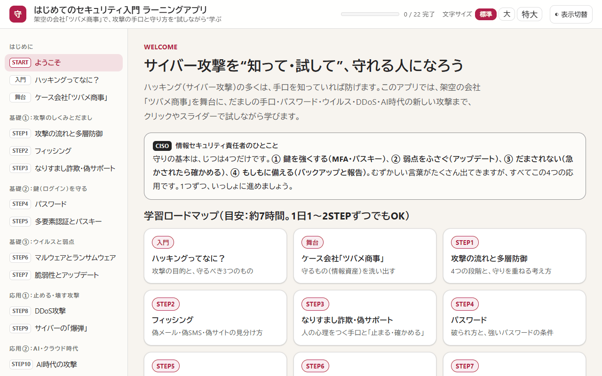
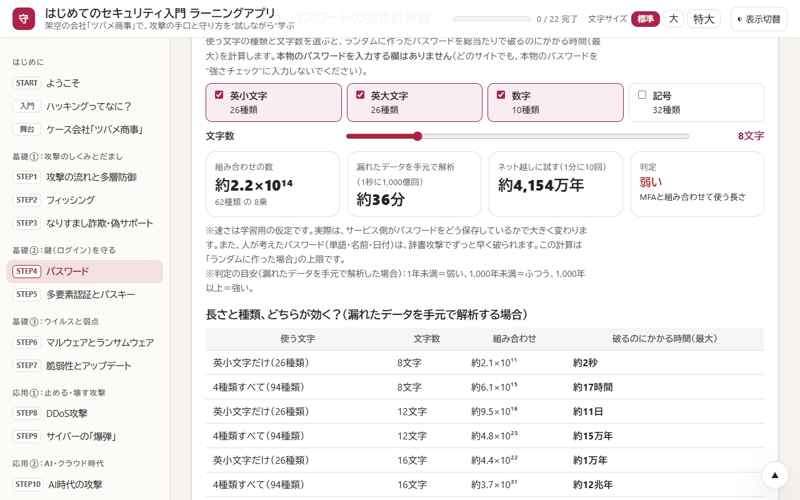

# はじめてのセキュリティ入門 ラーニングツール

ハッキング（サイバー攻撃）の手口と守り方を、クリックやスライダーで“試しながら”学ぶ、はじめての人向けの教材です。架空の会社「ツバメ商事」を舞台に、フィッシング・パスワード・ランサムウェア・DDoS攻撃・AI時代の新しい攻撃から、被害にあったときの初動と法律までを扱います。

> **English summary:** A beginner-friendly, interactive cybersecurity course (in Japanese) set in a fictional trading company. It covers phishing, passwords and passkeys, ransomware, DDoS, AI-era attacks such as deepfakes and prompt injection, incident response and Japanese law. It consists of a single-file offline HTML app (22 pages, 40-question quiz, 80-term bilingual glossary) and a 22-sheet Excel workbook with instant feedback. For defensive learning only; all names and data are fictional.

  

| 項目 | 内容 |
|---|---|
| 学習時間の目安 | 約7時間 |
| 学習アプリ | 全22ページ（レッスン18、確認クイズ40問、用語集80語・英語つき） |
| Excel ワークブック | 22シート |

## 目次

- [この教材でわかること](#この教材でわかること)
- [すぐに始める](#すぐに始める)
- [収録ファイル](#収録ファイル)
- [ケース会社（架空）](#ケース会社架空)
- [カリキュラム](#カリキュラム)
- [試しながら学べること](#試しながら学べること)
- [学び方](#学び方)
- [動作環境](#動作環境)
- [よくある質問](#よくある質問)
- [注意事項](#注意事項)
- [利用について](#利用について)
- [このシリーズのほかの教材](#このシリーズのほかの教材)

## この教材でわかること

守りの基本は、次の4つだけです。むずかしい言葉がたくさん出てきますが、すべてこの4つの応用です。

1. 鍵を強くする（多要素認証・パスキー）
2. 弱点をふさぐ（アップデート）
3. だまされない（急かされたら、別の方法で確かめる）
4. もしもに備える（バックアップと、早めの報告）

**こんな人に向いています**

- セキュリティを基礎から学びたい人（専門知識は不要です）
- 小さな会社で、情報システムの担当をまかされた人
- 家族や職場の人に、だましの手口と守り方を説明したい人

## すぐに始める

インストールもアカウント登録もいりません。

1. このページの上にある緑色の **［Code］** ボタン → **［Download ZIP］** で、ファイル一式をダウンロードします。
2. ダウンロードした ZIP ファイルを展開します（Windows は右クリック → **［すべて展開］**、Mac はダブルクリック）。
3. **`セキュリティ入門ラーニングアプリ.html`** をダブルクリックすると、ブラウザで学習アプリが開きます。
4. **`セキュリティ入門ラーニングワークブック.xlsx`** を Excel で開きます。画面の上に「保護ビュー」の帯が出たら、**［編集を有効にする］** を押してください（押さないと答えを入力できません）。

> [!NOTE]
> GitHub の画面で `.html` ファイルをクリックすると、アプリではなく中身のコードが表示されます。アプリとして使うときは、ダウンロードしてから開いてください。1つのファイルだけ必要なときは、ファイルを開いて右上の **［Download raw file］**（下向き矢印のボタン）を押します。

## 収録ファイル

| ファイル | 内容 |
|---|---|
| [セキュリティ入門ラーニングアプリ.html](セキュリティ入門ラーニングアプリ.html) | 学習アプリ。全22ページ（レッスン18、確認クイズ40問、CISOの実務ノート、用語集80語）。各レッスンの最後に確認問題があります |
| [セキュリティ入門ラーニングワークブック.xlsx](セキュリティ入門ラーニングワークブック.xlsx) | 実践ワークブック（22シート）。黄色いセルに答えや自分の状況を入れると、すぐに判定が出ます（確認テスト40問を含め、判定は100か所以上） |

## ケース会社（架空）

ツバメ商事株式会社。文具・事務用品の卸売とネット通販の会社で、社員60人、売上は年30億円、取引先は300社です。あなたは、経理と兼務で情報システムの担当に任命されたばかり。社長・経理部長・営業の新人・保守を任せている外部の会社と一緒に、この1年に起きた“ヒヤリ”から守り方を学びます。

## カリキュラム

| 区分 | レッスン |
|---|---|
| はじめに | ハッキングってなに？（守るべき3つのもの：機密性・完全性・可用性）、ケース会社「ツバメ商事」 |
| 基礎① 攻撃のしくみとだまし | STEP1 攻撃の流れと多層防御、STEP2 フィッシング、STEP3 なりすまし詐欺・偽サポート |
| 基礎② 鍵（ログイン）を守る | STEP4 パスワード、STEP5 多要素認証（MFA）とパスキー |
| 基礎③ ウイルスと弱点 | STEP6 マルウェアとランサムウェア、STEP7 脆弱性とアップデート |
| 応用① 止める・壊す攻撃 | STEP8 DDoS攻撃、STEP9 サイバーの「爆弾」（ロジックボム・メール爆弾・ZIP爆弾・フォーク爆弾） |
| 応用② AI・クラウド時代 | STEP10 AI時代の攻撃（ディープフェイク・プロンプトインジェクション）、STEP11 秘密情報と共有の設定ミス |
| 実践 守りを固める | STEP12 自分を守る基本セット、STEP13 会社を守るしくみ（10大脅威・ゼロトラスト・内部統制）、STEP14 安全なアプリの作り方 |
| 実践 もしものとき | STEP15 被害にあったら（初動と相談先）、STEP16 法律とルール |
| 仕上げ | 確認クイズ（40問）、CISOの実務ノート、用語集 |

## 試しながら学べること

- 攻撃の種類と守りのON/OFFを選んで、どこで止まるかを見る「多層防御シミュレーター」
- 偽メールのあやしいところ探しと、本物・偽物を見分ける「URLの読み方」の練習
- 文字の種類と長さで、破るのにかかる時間が変わる「パスワードの強さ計算機」（本物のパスワードを入力する欄はありません）
- 攻撃の種類ごとに、どのログインの方式なら防げるかの比較（SMS・認証アプリ・プッシュ通知・パスキー）
- バックアップの置き方で、ランサムウェアから元に戻せるかどうかの比較
- AIアシスタントに与える権限と人の確認で、隠された命令の被害が変わる体験
- 被害に気づいたときの、初動の順番の並べ替え

画面の例：パスワードの強さ計算機

 

  

## 学び方

1. 「ハッキングってなに？」と「ケース会社」で全体をつかみ、STEP1 から順に進めます。STEP1〜7 が基礎、STEP8〜11 が応用、STEP12〜16 が実践です。
2. 各レッスンの最後に確認問題があります。最後の確認クイズ（40問）では、まちがえた問題の振り返りと、まちがえた問題だけの解き直しができます。
3. Excel の各シートの「やってみよう」で、黄色いセルに答えを入れると、すぐに判定が出ます。答えは、シートの黄色いセルで「表示する」を選ぶと見られます。各シートの3行目にある「≡ 目次」「◀ 前」「次 ▶」で順番に移動できます。
4. Excel の「STEP12 自分を守る」の自己診断とバックアップのチェックや、「STEP4 パスワード」のアカウントの棚卸しは、自分の状況を入れて、そのまま使えます（パスワードそのものは、どこにも書かないでください）。

> [!TIP]
> 学習アプリは、文字の大きさ（標準・大・特大）と、明るい表示・暗い表示を、画面右上で切り替えられます。

## 動作環境

| ファイル | 必要なもの | 補足 |
|---|---|---|
| 学習アプリ（`.html`） | Microsoft Edge、Google Chrome などのブラウザ | 1つのファイルで動きます。通信を禁止する設定（Content Security Policy）を入れてあり、外部とは通信しません。進み具合とクイズの最高点は、使っているブラウザの中にだけ保存されます |
| ワークブック（`.xlsx`） | Microsoft Excel | マクロは使っていません |

2026年11月に、Windows 11 の Microsoft Edge で全ページの表示を、Microsoft 365 の Excel で全シートの計算（エラーが出ないこと）を確かめています。

## よくある質問

GitHub で HTML ファイルを開くと、文字（コード）ばかり表示されます

 
GitHub は HTML ファイルをアプリとして動かさず、中身のコードを表示します。<a href="#すぐに始める">すぐに始める</a>の手順でダウンロードしてから、ブラウザで開いてください。

Excel で答えを入力できません

 
インターネットから入手したファイルは「保護ビュー」（読み取り専用）で開きます。画面の上の帯にある［編集を有効にする］を押すと、入力できるようになります。

進み具合はどこに保存されますか？

 
アプリを開いたブラウザの中（localStorage）にだけ保存され、外部には送られません。別のパソコンや別のブラウザには引き継がれません。記録を消したいときは、ブラウザの閲覧データ（サイトデータ）を削除してください。

## 注意事項

> [!IMPORTANT]
> **この教材は、身を守るためのものです。** 学んだ手口を、他人のパソコンやサービスで試すと犯罪になります（不正アクセス禁止法など）。試すのは、自分の環境と、この教材の中だけにしてください。

- 会社・人物・数字は、すべて架空です。URL は、実在のサイトと重ならないよう、説明用に予約された「.example」を使っています。
- IPA「情報セキュリティ10大脅威 2026」、法令（e-Gov法令検索）、個人情報保護委員会、米国NISTのガイドライン（SP 800-63B-4）などの公開情報をもとに、2026年11月時点の内容をやさしくまとめています。相談窓口の連絡先や制度は変わることがあるので、使うときは公式サイトで最新の情報を確かめてください。
- 会社や学校のルールがある場合は、そちらを優先してください。

## 利用について

- 個人の学習や、勉強会・研修の教材として、自由に使ってください。自分用に内容を直して使ってもかまいません。
- ファイルを販売したり、有料の講座でそのまま配ったりする場合は、先に [Issues](https://github.com/rebelnaoto7/cybersecurity-learningtool/issues) でご相談ください。
- 正確さには注意して作っていますが、誤りがあるかもしれません。見つけたときは [Issues](https://github.com/rebelnaoto7/cybersecurity-learningtool/issues) で教えてください。

Microsoft、Windows、Microsoft 365、Microsoft Edge、Excel、Word、Power BI、Copilot は、Microsoft グループの商標です。この教材は、Microsoft が提供・承認したものではありません。そのほかの会社名・サービス名・製品名は、それぞれの会社の商標または登録商標です。

## このシリーズのほかの教材

| 教材 | ひとことで |
|---|---|
| [はじめての連結決算](https://github.com/rebelnaoto7/Consolidated-financial-statements-learning-tool) | 架空の10か国グループで、連結決算のしくみを学ぶ |
| [外資系コントローラー養成ツール](https://github.com/rebelnaoto7/Financial-Controller-Leaning-Tool) | 外資系企業の日本法人で、月次決算・本社報告・税務・資金繰りから Power BI まで |
| [M&Aアドバイザー養成ツール](https://github.com/rebelnaoto7/MA-advisor-learning-tool) | 売り手のFAとして、企業価値の評価・交渉・DD・契約・PMI を学ぶ |
| [日本株・米国株 分析ラーニングツール](https://github.com/rebelnaoto7/stock-analysis-learning-tool) | ファンダメンタル分析とテクニカル分析を、初級から超上級まで |
| [スモールビジネス起業・経営ツール](https://github.com/rebelnaoto7/small-business-starts-and-management-tool) | 小さなお店の開業から経営まで。自分の事業に使える計画用の Excel つき |
| [はじめての Power BI マーケティング分析](https://github.com/rebelnaoto7/Power-BI-and-Marketing) | マーケティングの数字の読み方と、Power BI でのダッシュボード作り |
